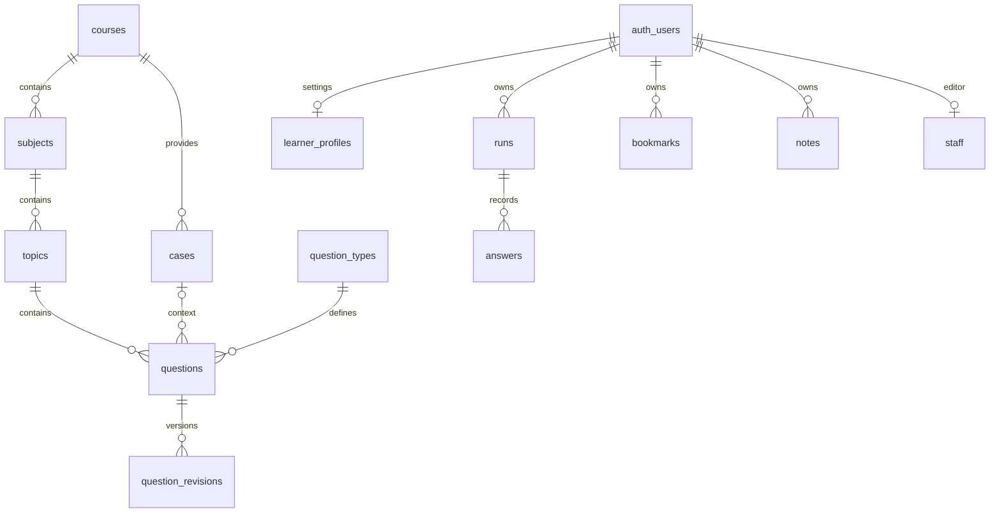

# 문제연습 (Practice Lab)

과정별 문제 제공, 문제 풀이, 시간 제한 모의고사와 오답 복습 서비스입니다. 첫 콘텐츠로 AI 역량평가 준비용 자체 제작 **36문항**을 제공합니다. 공개 체험 문제 원문이나 수집한 첨부 파일은 포함하지 않습니다.

## 실행

저장소 루트에서:

```bash
npm run install:practice
npm run dev:practice
```

기본 주소는 `http://localhost:5175`입니다. 포털은 기존 `npm run dev`로 실행하며 새 서비스가 목록에 표시됩니다. 앱을 직접 실행할 때는 이 폴더에서 `npm ci`, `npm run dev`를 사용합니다. Node.js 22.18 이상이 필요합니다.

```bash
npm run check:practice
npm run test:practice
npm run build:practice
```

운영은 포털과 같은 Vercel 프로젝트에 포함되며 `/ai-practice`에서 실행합니다. 저장소 루트에서 `npm ci`, `npm run build`로 함께 빌드합니다. 독립 개발 서버(5175)도 유지합니다. 통합 실행의 Supabase 변수는 루트 환경 파일과 기존 Vercel 프로젝트에서 설정합니다.

## 현재 동작

- 과정·과목·단원 및 상태별 문제 검색과 선택 연습
- 선택형·단답형 채점, 해설, 풀이 메모, 북마크, 마지막 제출 기준 오답 복습
- 과정 설정에 따른 모의고사 문항 수·제한 시간, 검토 표시와 자동 제출
- 답안·진행 상태 자동 저장과 새로고침 후 이어 풀기
- 문제은행 JSON 가져오기·내보내기, 전체 학습 기록 백업·복원
- Supabase Auth 이메일 로그인·가입, 계정별 브라우저 기록 분리
- 사용자 요청에 따른 클라우드 저장·불러오기와 저장 버전 충돌 검사
- Supabase 편집자 권한이 있는 사용자의 가져온 과정 게시

AI 과정의 1교시 20문항/30분, 2교시 16문항/90분은 안내받은 일정에 맞춘 **연습 템플릿**입니다. 개념형·사례형이라는 문제 구성은 실제 시험의 확정된 형식이 아닙니다. 실제 AI 도구 사용 허용 여부를 이 앱이 결정하지 않습니다.

학습 기록은 브라우저에 자동 저장됩니다. 클라우드에는 계정 메뉴의 **현재 기록 클라우드 저장**을 누를 때 저장됩니다. 다른 기기에서는 **클라우드 기록 불러오기**로 가져옵니다. 게스트와 계정별 기록은 별도 저장되며 로그인한다고 게스트 기록이 자동 이관되지는 않습니다. 필요한 게스트 기록은 백업한 뒤 해당 계정에서 복원할 수 있습니다. 완료한 풀이 최대 50회를 보관합니다.

## 공통 Supabase 설정

기존 농장 서비스와 **같은 Supabase 프로젝트**를 사용합니다. 이 앱에서 별도 Supabase 스택을 만들지 않습니다.

1. `.env.example`을 `.env`로 복사하고 `PUBLIC_SUPABASE_URL`, `PUBLIC_SUPABASE_PUBLISHABLE_KEY`에 공통 프로젝트 URL과 공개 키를 설정합니다. 브라우저에 service-role/secret 키를 넣지 않습니다. 환경변수를 바꾸면 개발 서버를 다시 시작합니다.
2. 공통 `backend/supabase/migrations/`의 다음 두 마이그레이션을 적용합니다.
   - `202610130001_ai_practice.sql`: 스키마·RLS·RPC·수정 이력
   - `202610130002_ai_practice_seed.sql`: 첫 과정, 6개 단원, 4개 사례, 36문항
3. 운영 Supabase Dashboard의 **Exposed schemas**에 `ai_practice`를 추가합니다. 로컬 `backend/supabase/config.toml`에는 이미 반영되어 있습니다. [Supabase 사용자 정의 스키마 안내](https://supabase.com/docs/guides/api/using-custom-schemas)
4. Auth URL Configuration에 서비스 운영 주소와 로컬 `http://localhost:5175`, `http://127.0.0.1:5175`를 허용합니다. 가입 확인 메일은 `emailRedirectTo`로 이 앱을 가리킵니다. [리다이렉트 설정](https://supabase.com/docs/guides/auth/redirect-urls)

운영 적용 전에는 공통 backend 폴더에서 원격 이력과 미적용 마이그레이션 전체를 검토합니다. `supabase db push`는 이 서비스의 두 파일 외에 기존 미적용 파일도 반영할 수 있습니다. 이 작업에서는 운영 DB에 연결하거나 마이그레이션을 적용하지 않았습니다.

로컬 Supabase 스택은 Docker가 실행 중일 때 저장소 루트의 `npm run dev:backend`로 시작합니다. 기존 데이터가 있는 DB에 `db reset`을 실행하지 마세요. 검증용 새 로컬 스택 또는 검토된 증분 마이그레이션을 사용합니다.

## 데이터 구조와 권한



모든 테이블은 `ai_practice` 스키마에 있으며 RLS를 사용합니다. 기존 `farm_memberships`와 농장 테이블을 사용하지 않습니다.

| 객체 | 역할 |
| --- | --- |
| `courses / subjects / topics` | 시험·과정 → 과목 → 단원 계층, 과정별 모의고사 설정 |
| `question_types` | 문항 유형과 채점 방식 등록. 현재 화면은 `choice`, `short` 지원 |
| `cases / questions` | 공통 지문·자료와 문항. 관계 키 및 버전 1 JSON 콘텐츠 계약 |
| `question_revisions` | 문항 수정 시 당시 콘텐츠와 수정자 보존 |
| `learner_profiles` | 사용자별 추가 문제은행, 클라우드 저장 버전 |
| `runs / answers` | 풀이 당시 문제·자료 사본, 진행 상태, 응답과 정오 판정 |
| `bookmarks / notes` | 사용자별 북마크와 메모. 개인 추가 문제도 지원 |
| `staff` | DB 관리자가 명시적으로 부여하는 콘텐츠 편집 권한 |

익명 사용자는 게시된 과정과 문제만 읽을 수 있습니다. 답과 해설도 학습 콘텐츠로 공개합니다. 학습자 기록은 본인만 읽을 수 있으며, 직접 테이블 쓰기 대신 인증을 확인하는 `save_learning_state` RPC로 원자적으로 저장합니다. `p_revision`이 현재 버전과 다르면 저장을 거부하므로 다른 기기의 새 기록을 조용히 덮어쓰지 않습니다. 모든 소유자는 `auth.uid()`로 결정하며 클라이언트가 다른 사용자 ID를 지정할 수 없습니다.

`publish_bank`는 편집자만 실행할 수 있으며 과정·과목·단원·사례·문항을 한 트랜잭션으로 게시합니다. 일반 가입자는 편집자가 될 수 없습니다. DB 관리자가 승인한 계정에만 다음과 같이 권한을 부여합니다.

```sql
insert into ai_practice.staff(user_id, role)
values ('승인한-auth.users-UUID', 'editor');
```

이 서비스는 개인 학습용입니다. 직접 추가한 문제와 답을 사용하며 서버의 점수도 풀이 사본에서 계산합니다. 부정행위 방지·비공개 정답·공식 성적 인증 시스템은 아닙니다. 감독 시험이나 공인 순위 기능을 도입하려면 비공개 정답 저장소와 서버 고정 문항 출제·채점 경계를 별도로 구현해야 합니다.

## 새 시험·과목 추가

앱의 **과정·문제 관리 → 새 과정 예시 파일**에서 [example-course.json](static/example-course.json)을 내려받아 수정한 뒤 가져옵니다. SQL 기초 과정은 구조 설명용 자체 제작 예시이며 특정 자격시험 기출문제가 아닙니다.

필수 계층은 다음과 같습니다.

```text
courses[].id
  subjects[].courseId
    topics[].subjectId
      questions[].courseId / subjectId / topic
```

ID는 문제은행 전체에서 고유하게 유지하세요. 문항 ID는 영문·숫자·밑줄·하이픈을 사용합니다. 기존 ID와 겹치는 문제를 가져오면 교체 확인을 표시합니다. 과거 풀이에는 이전 문제 사본이 유지됩니다.

- `course.exams[]`: `id`, `title`, `section`, `count`, `minutes`, `description`. 고정된 AI 시험명이 아닌 과정별 설정으로 동작합니다.
- `question.section`: 모의고사에서 선택할 문항 묶음입니다. `basics`, `korean`, `administrative-law` 등 임의의 식별자를 사용할 수 있습니다.
- `question.kind: "choice"`: `choices` 2–6개, `answers`는 **0부터 시작하는 선택지 인덱스의 문자열 배열**입니다. 예: 세 번째 선택지가 정답이면 `["2"]`.
- `question.kind: "short"`: `answers`에 허용할 정답 문자열을 넣습니다. NFKC 정규화·공백 제거·대소문자 통일 후 비교하며 숫자 오차, 단위, 쉼표, 순서를 임의로 무시하지 않습니다.
- `caseId`: 같은 과정의 공통 자료 ID와 연결합니다. 사례는 표, 설명, 안내를 제공합니다.

문제은행 가져오기는 파일당 4MB·500문항, 합쳐진 문제은행은 최대 5,000문항을 지원합니다. 오류가 있는 참조·선택지·정답은 가져오기 전에 거부합니다. 게시 권한이 없는 사용자의 추가 문제는 개인 학습 공간과 본인의 백업·클라우드 기록에만 포함됩니다.

DB의 유형 등록부에는 향후 복수 선택(`multiple`), 서술형(`essay`) 확장 자리가 있습니다. 해당 유형을 실제 제공하려면 `bank.ts`의 타입, `engine.ts`의 검증·채점, `QuestionBody.svelte`의 입력·해설 화면, DB 채점 RPC를 함께 확장해야 합니다. 미구현 유형을 현재 화면이 지원한다고 표시하지 않습니다.

## 검증

`npm test`는 문제은행 참조, 채점, 시간 종료, 복원과 확장 예시를 검증합니다. DB 테스트는 PGlite의 PostgreSQL 엔진에서 두 마이그레이션을 실제 실행하고 Supabase Auth의 최소 계약을 모사하여 다음을 검사합니다.

- 익명/소유자/다른 사용자/편집자의 조회와 쓰기 권한
- 답안·문항 사본·메모·북마크 저장과 복원
- 저장 버전 충돌 및 잘못된 입력의 전체 롤백
- 다른 사용자 풀이 UUID 도용과 편집자 자기 승격 거부
- 새 과정 게시, 문항 수정 이력, 비공개 과정의 노출 차단

PGlite 검증은 실제 운영 Supabase의 Auth·PostgREST·이메일·Exposed schemas 설정을 대신하지 않습니다. 운영 연결 후 로그인, 게시 목록 조회, 기록 저장·불러오기까지 별도 확인해야 합니다.

## 모바일 화면

좁은 화면에서는 현황·문제·모의고사·오답·관리 메뉴를 하단에 고정합니다. 문제 풀이 중에는 학습 메뉴 대신 이전·정답 확인·다음·제출 버튼을 고정하고, 상단의 문항 목록에서 번호를 선택해 이동할 수 있습니다. 검토 표시와 창 닫기, 키보드 포커스 복귀를 지원합니다.

- 작은 화면의 입력 필드는 16px 이상, 주요 풀이 버튼은 최소 48px 높이를 사용합니다.
- 숫자 단답형은 숫자 입력 키보드를 요청하며, 표는 자체 영역 안에서 가로 스크롤합니다.
- 노치·홈 표시줄 안전 영역, 화면 회전, 하단 메뉴와 알림 위치를 고려합니다.
- 320×740, 390×844, 768×1024, 1024×768, 844×390에서 주요 화면의 가로 넘침과 메뉴 터치 영역을 확인했습니다. 이는 브라우저 반응형 검증이며 실제 iOS·Android 기기 검증을 대신하지 않습니다.
